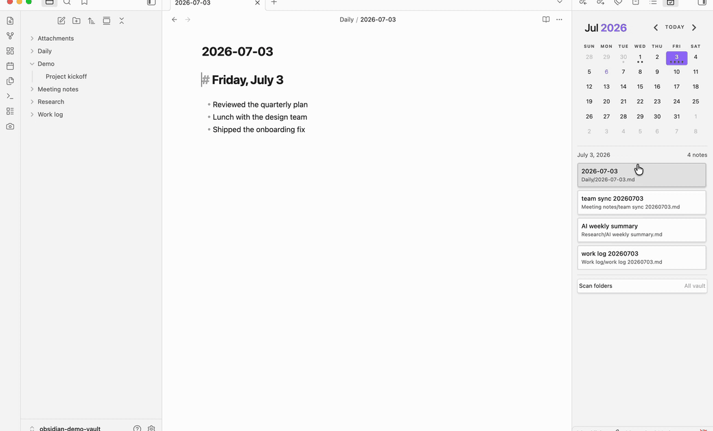

**English** | [简体中文](README.zh-CN.md)

# Calendar Hub

> One calendar, **every** note from that day — and a List view to browse them all by week, month, quarter, or year.

Most calendar plugins map **one note per day**. Calendar Hub doesn't: click a date and it
surfaces **every note dated to that day** — by its frontmatter, its filename, or (optionally) its
creation date — wherever it lives in your vault. And when you want the bigger picture, flip the
same pane into a **List view** and browse everything by period, filtered to just the folders you
care about.



## Why Calendar Hub?

If you generate a lot of notes — daily logs, meeting notes, AI-generated summaries — they
scatter across folders and get hard to track down. A normal calendar only knows about your one
configured Daily Note, so everything else stays invisible.

Calendar Hub groups notes by the day they belong to, so a single date can surface many notes at
once:

- `Daily/2026-05-29.md`
- `Work log/work log 20260529.md`
- `Meeting notes/team sync 20260529.md`

Click the day, see all three. Or open the List view and read through everything from that week,
that month, that quarter — one area of the vault at a time.

## Calendar Hub vs. the original Calendar

Calendar Hub is a fork of Liam Cain's Calendar, so everything you expect still works — the
monthly view, daily and weekly notes, note-count dots, and "reveal active note." It adds what
Calendar was missing:

| | Calendar | Calendar Hub |
|---|---|---|
| Notes per day | One configured Daily Note | **Every matching note, in any folder** |
| Browsing | Month grid only | **List view by year / quarter / month / week** |
| Folder scope | Daily Notes folder only | **Whole vault, or rule-based folder filters with exclusions** |
| Date detection | Daily Notes filename | **Frontmatter + filename (extra formats) + creation date** |
| Weekly notes · dots · theming | ✓ | ✓ |

It uses its own plugin id (`calendar-hub`), so you can run it alongside Calendar and switch only
once you are happy.

## The calendar

- Click a day to update the note list below the calendar. If one note matches, it opens
  directly; if several match, choose one from the list. If none match, **Clicking a date with
  no notes** decides what happens: ask before creating a note (the default), create one right
  away, or only select the day.
- Use **+ New note** at the top of the selected day's list to create and open another note
  immediately, without a confirmation dialog. Notes use your Daily Notes or Periodic Notes
  folder, filename format, and template: for example, `2026-10-28.md`, then
  `2026-10-28 (1).md`, `2026-10-28 (2).md`, and so on. Template `{{date}}` stays a date;
  `{{title}}` includes the numbered suffix.
- Numbered notes are indexed like any other note, as long as the daily-note folder is within
  your scan scope.
- Note-count dots show how many matching notes each day has. Set the cap from 1 to 5 with
  **Maximum dots per day** (default: 5); the note list still shows every match.
- Weekly-note support remains available through the week-number setting.

## The List view

The List view shows every indexed note as a collapsible tree — **Year**, **Year › Quarter**,
**Year › Month**, or **Year › Week** — newest or oldest first, with note counts on every group
header. Today's branch starts expanded, and clicking a note opens it.

It has two homes:

- **In the Calendar Hub pane**: the right-aligned button at the top of the sidebar flips
  the same pane into the list and back. When you move the pane to the main workspace, use
  the view-header button instead; the extra in-pane toolbar is hidden while the header is
  visible. Some themes reveal sidebar buttons only on hover. The mode you choose is remembered.
  Turn off **Show view switcher in sidebar pane** for a cleaner pane; **Open calendar view**
  still flips the pane back to the calendar, and **Open list view** opens the list in its own tab.
- **As its own tab**: run the **Open list view** command and drag the tab anywhere — including
  the main workspace for full-height browsing.

The list also carries its own **Filter folders** lens: the same checkbox tree as the scan scope,
applied instantly and cleared with one click. Focus the list on `30 Macro` for a quarter-by-
quarter read-through without touching what the calendar indexes. If a note appears on the
calendar but not in the list, check this list-specific filter.

## Folder filtering

Two layers, two jobs:

- **Scan scope** (Settings → *Folders*) decides what the calendar indexes, for daily and
  weekly notes alike. A collapsible checkbox tree starts with **Whole vault**: leave it ticked
  and untick the folders you want left out, or untick it and tick only the folders you want.
  A dash marks branches that mix included and excluded folders. The text field holds the same
  scope as a rule list: plain entries include a subtree, `-` prefixed entries exclude one, and
  deeper rules win — so `30 Macro, -30 Macro/Archive` scans 30 Macro except its Archive.
- **The list's Filter folders lens** narrows what the list shows, *within* the scan scope. It
  never changes the calendar.

## Date matching

Calendar Hub maps Markdown files to calendar dates in this order:

1. Frontmatter date fields (when enabled) — a note's declared date always wins.
2. Exact Daily Notes filename match using your configured Daily Notes format.
3. Date embedded in the filename using the Daily Notes format.
4. Date embedded in the filename using any extra formats you configure.
5. File creation date fallback (optional), only when nothing above yields a date.

Frontmatter dates take priority over filename dates, and both take priority over the
creation-date fallback — creation times are set by your device and can change when files are
copied or re-synced, which is why declared dates always win. Folder filters apply to every
matching source.

Datetime formats work too: `YYYYMMDDTHHmmssZZ` matches timestamps like `20260709T143025Z` or
`20260709T143025+0800`, and a timestamp with a UTC offset maps to the calendar day written in
the name, not converted to your local timezone — the same vault buckets identically on machines
in different timezones.

## Settings

Settings are split into three tabs.

**General**

- **Start week on** and **Override locale**: Calendar layout and language.
- **Maximum dots per day**: Choose 1–5 note-count dots (default: 5). The cap also applies to weekly note-count dots and never limits the notes shown in the list.
- **Clicking a date with no notes**: Ask before creating a note (default), create one immediately, or only select the date. The **+ New note** button and the **Open weekly note** command always create immediately.
- **Show view switcher in sidebar pane**: Show the in-pane calendar/list switch when Calendar Hub is docked in a sidebar. Turn it off for a cleaner pane; **Open calendar view** still flips the pane back to the calendar, and **Open list view** opens the list in its own tab.
- **Show week numbers**: Add a week-number column; clicking a week number opens or creates that week's note. When Periodic Notes is not managing weekly notes, the **Weekly note format**, **template** and **folder** used for new weekly notes appear here too.

**Folders**

- **Folders to scan**: The checkbox tree described under [Folder filtering](#folder-filtering), shared by daily and weekly notes. The text field holds the same scope as comma-separated folder paths; prefix a path with `-` to exclude its subtree (e.g. `30 Macro, -30 Macro/Archive`); deeper rules win.

**Date matching**

- **Frontmatter date fields**: Fields such as `date`, `daily_date`, or `calendar.date`, tried in the order you list them; the first valid date wins and beats the filename. Leave blank to match on filenames only.
- **Date format inside daily note filenames**: Pick common formats from the dropdown, or add comma-separated formats by hand, such as `YYYYMMDD` or `YYYYMMDDTHHmmssZZ`.
- **Use file creation date fallback**: Map notes without any declared date to the day the file was created on disk.
- **Weekly frontmatter fields** (with week numbers on): Fields that place a note in a week, such as `week`; a week string or a date both work. Leave blank to match weekly notes on filenames only.

## Installation

Calendar Hub is available in the Obsidian **Community Plugins** directory:

1. Open **Settings → Community plugins → Browse**.
2. Search for **Calendar Hub** and install it.
3. Enable it. The Calendar Hub pane is created in the right sidebar; use the **Open calendar view** command to reveal it.

<details>
<summary>Manual or beta install</summary>

Install the latest commit with [BRAT](https://github.com/TfTHacker/obsidian42-brat) using the
repository `HWY1dot0/calendar-hub`, or download `main.js`, `manifest.json`, and `styles.css` from
a [release](https://github.com/HWY1dot0/calendar-hub/releases) and copy them into
`.obsidian/plugins/calendar-hub/` inside your vault, then reload Obsidian and enable the plugin.

</details>

## Commands

- **Open calendar view**: Reveals the Calendar Hub pane, creating it in the right sidebar if needed, and returns it to calendar mode if it was showing the list.
- **Open list view**: Opens the standalone List view (right sidebar by default; drag it anywhere).
- **Reveal active note in calendar**: Moves the calendar to the month for an active note whose filename exactly matches the configured daily- or weekly-note format (flips the pane back to the calendar first if it is showing the list).
- **Open weekly note**: Opens or creates the current weekly note when legacy weekly-note support is enabled.

## Compatibility

Calendar Hub requires Obsidian `1.7.2` or newer.

The plugin uses Obsidian theme variables and should follow light and dark themes without custom CSS.

## Relationship To Calendar

This plugin is based on Liam Cain's original Calendar plugin for Obsidian:

https://github.com/liamcain/obsidian-calendar-plugin

The original project is MIT licensed. The original copyright notice remains in `LICENSE`, alongside copyright for this fork's modifications.

Calendar Hub uses its own plugin id, `calendar-hub`, so it can be installed separately from the original Calendar plugin.

Two of Liam Cain's MIT-licensed libraries are vendored unmodified (published build artifacts) under `vendor/`, each with its license and provenance header: [obsidian-calendar-ui](https://github.com/liamcain/obsidian-calendar-ui) 0.3.12 and [obsidian-daily-notes-interface](https://github.com/liamcain/obsidian-daily-notes-interface) 0.9.0. Vendoring keeps the plugin free of runtime npm dependencies.

## Contributors

Thanks to [@yszhou2019](https://github.com/yszhou2019) for contributing same-day note creation with automatically numbered filenames, configurable note-count dots, and view-switcher improvements in [PR #5](https://github.com/HWY1dot0/calendar-hub/pull/5), released in version 0.2.4.

## Development

```bash
npm install
npm run build
```

## More plugins by HWY1dot0

- [Screenshot Selection](https://github.com/HWY1dot0/obsidian-screenshot-selection) — capture selected note content as a theme-faithful PNG.
- [Copy for Email](https://github.com/HWY1dot0/obsidian-copy-for-email) — copy notes as rich text that survives pasting into Gmail, Outlook and Apple Mail.

## Say Thanks

If Calendar Hub helps your workflow, you can buy me a coffee:

https://www.buymeacoffee.com/hwy1dot0
